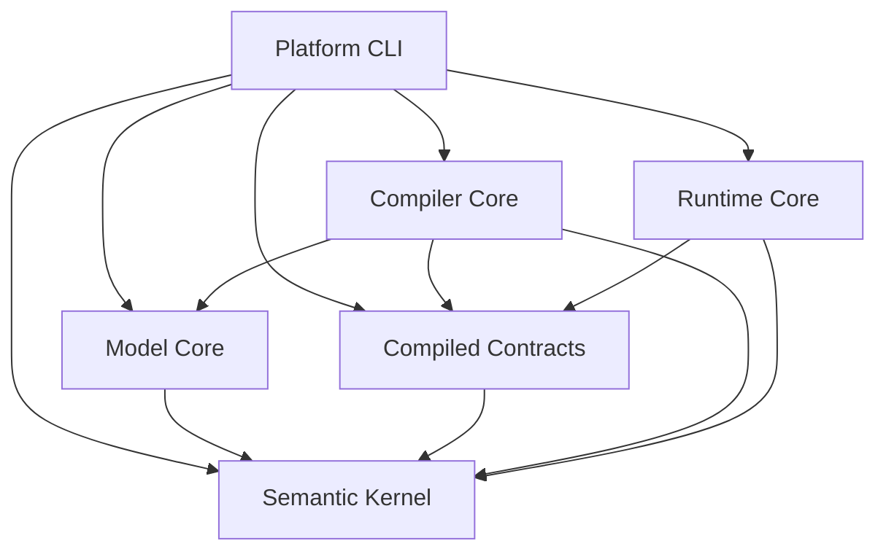

# ARC-01 architecture

The initial deployment model is one process composed of independently owned modules. Repository modularity does not imply microservices.

## Module graph

Arrows mean **depends on**; platform arrows are permitted edges; CLI arrows are observed development inspection edges, not fabricated feature implementations.

CLI inspects workspace metadata and uses explicit static public registration imports; it does not invoke future compiler/runtime behavior. `compiled-contracts` is a meaningful independent seam so neither compiler nor runtime owns the other's implementation. Its current public marker does not pretend to implement semantic IR.

Read [structure](repository-structure.md), [rules](dependency-rules.md), [guidelines](module-guidelines.md), [ADR-0001](decisions/ADR-0001-modular-monolith.md), [ADR-0002](decisions/ADR-0002-python-workspace.md) and [verification](verification.md).

ARC-02 now enforces dependency governance. Selected future adapters are Angular/PrimeNG and Django/DRF with contract-based mock data; no framework behavior is implemented. See ADR-0003 and ADR-0004.

ARC-03 provides [executable architecture fitness functions](fitness-tests.md), maintaining ARC-02 policies while separating discovery, rules and reporting. ADR-0005 records the harness and governed temporary exceptions. No semantic implementation or UI/API behavior is added.

ARC-04: see [platform bootstrap](platform-bootstrap.md). Hosting contracts live in `platform/bootstrap/contracts`; concrete composition/configuration/lifecycle lives in CLI internals. Activation dependencies are separate from architectural allowed imports. TestHost and fakes are test-only.

ARC-05: [CLI usage and extension](../developer/cli.md), [ADR-0007](decisions/ADR-0007-cli-as-thin-developer-adapter.md). CLI registration/handlers/rendering are separated; core remains independent of tooling.

SK-01: [SemanticElementId](../kernel/semantic-element-id.md), [ADR-0008](decisions/ADR-0008-semantic-element-identity.md). The existing Kernel owns the pure identity; serializer mapping remains outside Kernel production code.

### RUN-01 runtime boundary

Existing `runtime-core` now owns pure requests/authority/decoder ports, bounded loading, typed immutable inactive output and structured diagnostics, still importing only Kernel/compiled-contracts. Shared contracts add optional producer-owned encoding/runtime declarations without approving a format. New `tools/runtime-artifact-loader` module explicitly composes only compiler-core/runtime-core public APIs under constrained tooling profile `runtime-artifact-loading`, retaining actual CMP-07/08/09 evidence and invoking the existing reader once. No runtime-to-compiler edge, private import, zone relaxation, exception, framework/HTTP/ORM/activation or real producer/decoder/auth integration. [Contract](../runtime/runtime-artifact-loader.md), [ADR-0042](decisions/ADR-0042-runtime-artifact-loader.md), [188 deferred cases](../../test-archive/RUN-01/RUN-01-deferred-tests.md), [static record](run01-verification.md). Tests created/executed **0**, **DEFERRED / NOT VERIFIED**; stop RUN-01.

### RUN-02 — Exact runtime registry

Existing runtime-core adds explicit original-loaded-node extraction, exact context/target/version keys, distinct mutation/read authority, private locked copy-on-write membership, immutable snapshots, numeric version/name inspection and existing runtime diagnostic extensions. Kernel/compiled-contracts remain its only public dependencies; no module, upstream compiler/model/reader/authoring edge, exception, framework/HTTP/ORM/activation change. Runtime stdlib allows `threading` only to support the implemented private Lock; no worker/Thread startup. No real decoder/extractor/definition kind/authority is invented; default integrations fail closed. [Contract](../runtime/runtime-model-registry.md), [ADR-0043](decisions/ADR-0043-runtime-model-registry.md), [198 deferred cases](../../test-archive/RUN-02/RUN-02-deferred-tests.md), [static record](run02-verification.md). Tests created/executed **0**, **DEFERRED / NOT VERIFIED**; stop RUN-02.

### RUN-03 semantic instance application composition

New `apps/semantic-instance-runtime` composes public Kernel/model-core/compiled-contracts/runtime-core APIs under the existing application zone. Runtime-core still has no model/compiler/framework edge; no zone policy, profile, core contract or activation is changed. Conditional create/update/inspect uses original exact RUN-02 entries, canonical TYPE-08 owner ports, stable FieldId, explicit Missing/Null/Value inspection, independent permissions, immutable output and local expected revisions. Actual TYPE-08/loaded schema/decoder/authority/decimal evaluator integrations are absent and fail closed, without a fabricated canonical class or successful instance. [Contract](../runtime/semantic-instance-runtime.md), [ADR-0044](decisions/ADR-0044-semantic-instance-runtime.md), [200 deferred cases](../../test-archive/RUN-03/RUN-03-deferred-tests.md), [static/source record](run03-verification.md). New/executed tests **0**, **DEFERRED / NOT VERIFIED**. Stop RUN-03.

### RUN-04 shared runtime validation

[Runtime validation](../runtime/runtime-validation.md) lives in the existing application composition module; no new module/public edge/core change or circular import. One authoritative complete-instance engine replaces RUN-03 duplicate field value checks and accepts candidates only on complete VALID. Known violations retain INVALID even with unavailable mandatory rules. Genuine TYPE-08/schema/evaluators/authenticated integration remains unavailable. [ADR-0045](decisions/ADR-0045-runtime-validation.md), [209 deferred scenarios](../../test-archive/RUN-04/RUN-04-deferred-tests.md), [completion record](run04-verification.md). New/executed tests0; **DEFERRED / NOT VERIFIED**; stop RUN-04.
